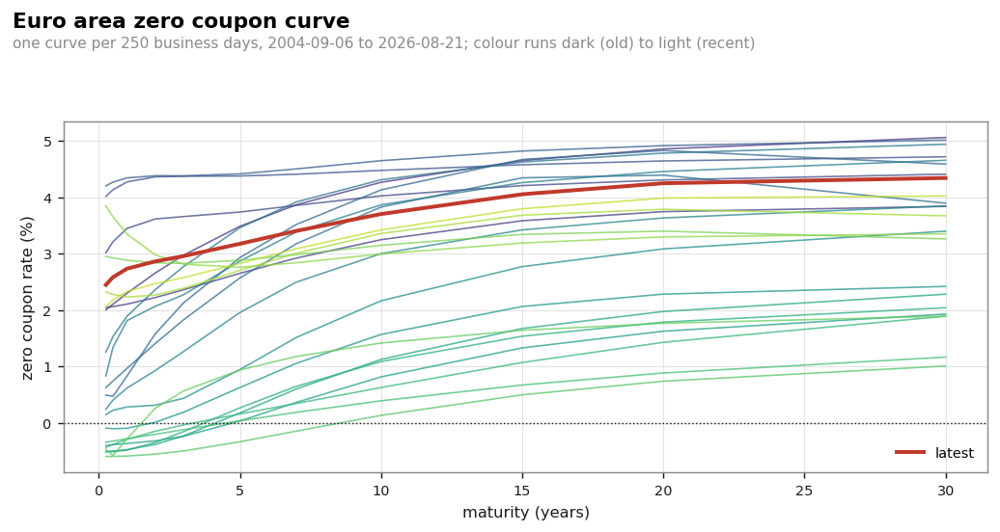
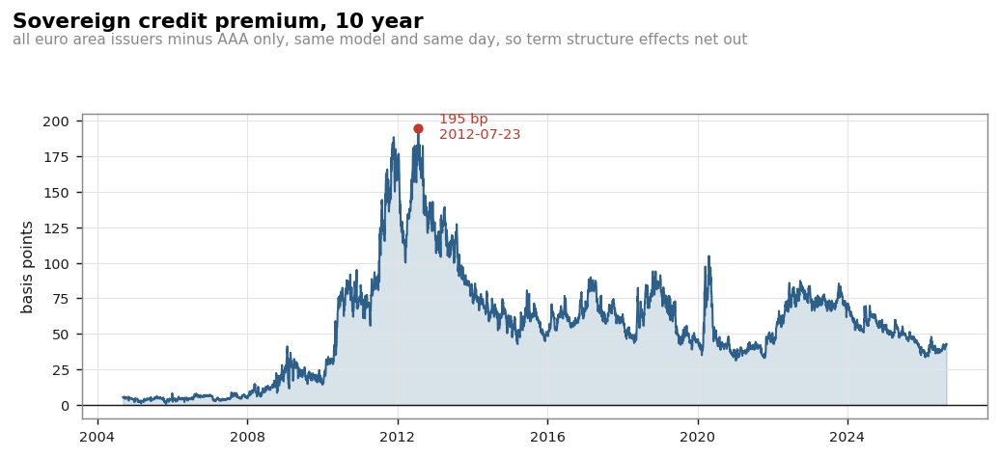
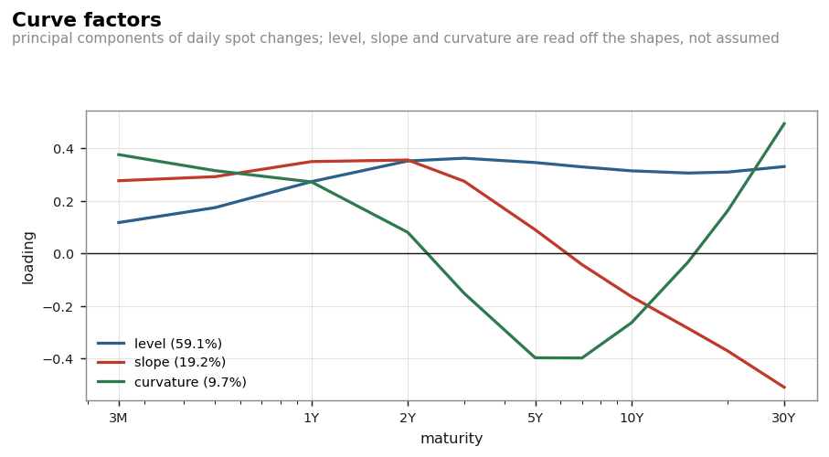
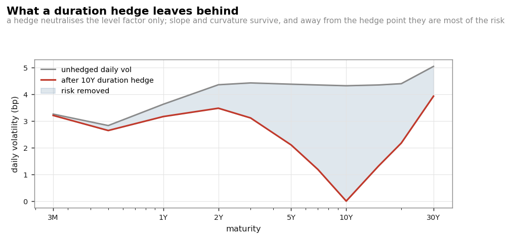
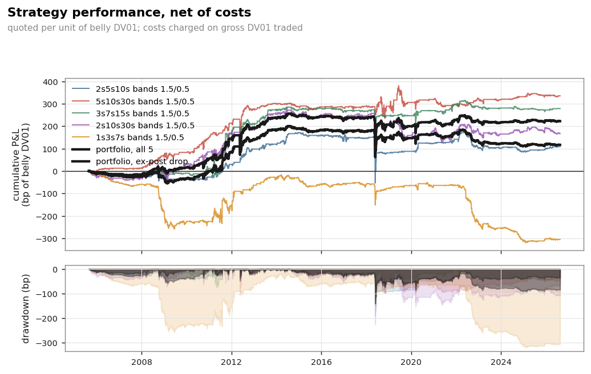

# Euro Area Yield Curve

Rebuilding the ECB's euro area yield curves, checking them against the
published rates, and using the curve for bond risk, PCA and a relative value
backtest. Python, ECB data 2004-2026.

A short note with the method and results: [note/euro-area-yield-curve.pdf](note/euro-area-yield-curve.pdf).



## Summary

- **Curve rebuilt from the ECB's Svensson parameters** and compared with the
  rates the ECB publishes: max error 1.5e-08 bp over 673,680 observations
  (all-issuers curve, 5,614 dates x 120 maturities).
- **Change in the published par yields on 19 May 2023, found in the data.**
  This is my own empirical finding; the ECB technical notes do not mention it.
  The par yield formula changes on that date and past data was not
  recalculated: 4,782 dates match the old formula, 832 match the new one, none
  match both.
- **PCA of daily curve moves:** three factors explain 98.6% of the variance out
  of sample. On the first half of the sample, over all 120 maturities, level
  explains 74.5%, slope 15.3% and curvature 6.2% (96.0% together).
- **Relative value:** PCA-neutral butterflies backtested 2005-2026 after costs.
  Portfolio Sharpe 0.16, t = 0.75, so not statistically significant.

## Run

```bash
pip install -r requirements.txt
python scripts/run_validation.py     # rebuild and check every published curve
python scripts/run_analysis.py       # spread, PCA, bond risk, carry and roll
python scripts/run_trading.py        # butterfly backtest
python scripts/run_calibration.py    # Svensson fit on US data (a few minutes)
python -m pytest tests/ -q           # 52 tests, no network needed
```

Data is downloaded from the ECB Data Portal (`data-api.ecb.europa.eu`, free,
no API key) and cached in `data/`. The numbers here use data up to 21 August
2026 (5,614 dates). A later download will move some of them slightly.

## 1. Rebuilding the curve

The ECB publishes both the daily Svensson parameters and the spot, forward and
par yield curves computed from them. So rebuilding the rates from the
parameters should give exactly the published numbers.

| Curve | Rate | Max error | RMSE | Dates above 0.01 bp |
|---|---|---|---|---|
| All issuers | spot | 1.5e-08 bp | 1.6e-09 bp | 0 |
| All issuers | instantaneous forward | 2.0e-08 bp | 1.6e-09 bp | 0 |
| All issuers | par yield | 2.8e-07 bp | 2.7e-09 bp | 0 |
| AAA | spot | 5.6 bp | 0.042 bp | 1 |
| AAA | instantaneous forward | 12.6 bp | 0.159 bp | 3 |
| AAA | par yield | 7.4 bp | 0.065 bp | 2 |

Things I had to get right to reach zero error:

- **Continuous compounding.** The series code `SV_C_YM` means Svensson /
  Continuous / Yield Minimisation. Treating the rates as annually compounded
  gives a 6.9 bp error at 10 years.
- **Par yield definition.** The ECB divides by the integral of the discount
  function (continuous annuity), not by an annual coupon schedule. Using a
  coupon schedule is off by 6.8 bp at 10 years.
- **The May 2023 change (my own finding from the data, not in the ECB notes).**
  Before 19 May 2023 the annuity is a monthly sum of
  discount factors, from that date it is the exact integral. The split is
  clean (4,782 / 832 / 0 dates) and the gap reaches 1.28 bp in November 2011.
  Both versions are implemented and chosen by date.

The AAA errors come from three dates (2007-05-23, 2020-07-15, 2022-06-23)
where the ECB's own AAA parameters and published rates do not agree. On two
of them tau1 and tau2 are almost equal, which makes the Svensson fit
unstable. The all-issuers curve is exact on those same dates.

## 2. Curve analysis

**Sovereign spread** (all issuers minus AAA, 10 years): mean 55.4 bp, peak
194.8 bp on 23 July 2012, just before Draghi's "whatever it takes" speech.



**PCA** on daily spot changes, loadings fitted on the first half of the sample
and tested on the second half: three factors explain 96.0% in sample and 98.6%
out of sample, over all 120 maturities. The figure uses the 11 tenors of the
trading study instead, so its shares are lower: 59.1%, 19.2% and 9.7% (88.0%
together) on the same first-half fit.



**Bond risk** on the latest curve (30-year bond, 2% coupon): effective
duration 20.11, of which 16.17 years sit in the 30-year key rate bucket. A
10-year hedge only covers 3.14 years. The key rate durations add up to the
effective duration (max gap 2e-06 years), which is used as a test.

**What a 10-year duration hedge leaves:** 77% of the variance removed at
5 years, 39% at 30 years, 3% at 3 months. Most of the remaining risk is slope
and curvature.



## 3. Relative value backtest

Butterflies (2s5s10s, 5s10s30s, 3s7s15s, 2s10s30s, 1s3s7s) with weights solved
to have zero exposure to level and slope, using a trailing 250-day PCA. Enter
at |z| > 1.5, exit at 0.5, 0.5 bp round-trip cost per unit of DV01. No
look-ahead: the position taken on day t earns the move from t to t+1.

| Strategy | Net P&L | Sharpe | t-stat | Max DD |
|---|---|---|---|---|
| 2s5s10s | 108 bp | 0.13 | 0.59 | -225 bp |
| 5s10s30s | 335 bp | 0.30 | 1.40 | -108 bp |
| 3s7s15s | 279 bp | 0.31 | 1.43 | -107 bp |
| 2s10s30s | 168 bp | 0.14 | 0.62 | -191 bp |
| 1s3s7s | -305 bp | -0.35 | -1.61 | -319 bp |
| **Portfolio** | **117 bp** | **0.16** | **0.75** | -139 bp |

No t-stat is above 2, so none of this is significant. Costs matter more than
the signal: trading the z-score continuously instead of with bands raises
turnover from ~11x to ~70x a year and makes the 2s5s10s negative.



## 4. Calibration on US data

The ECB does not publish the bond prices behind its curve, so the fitting part
is done on US data, where the Fed publishes its own Svensson parameters
(Gurkaynak-Sack-Wright) to compare against.

- When tau1 and tau2 are far apart, the optimiser recovers the Fed's parameters
  exactly. When they are close (13.5% of days), different starting points give
  parameters that differ by up to ~2,800 while giving the same curve (median
  curve error 0.002 bp).
  The curve is identified, the individual betas are not.
- Fitting Treasury par yields directly: median RMSE 2.0 bp, with 2 to 5
  different local minima per date.

## Limitations

- This is a government bond curve, not a swap/OIS curve, so it cannot be used
  to discount collateralised derivatives.
- The euro parameters are the ECB's, not re-estimated (the MTS bond prices are
  not public).
- No business-day calendar: cash flows are at exact year fractions.
- The backtest trades curve points, not real instruments (swaps or futures).

## Structure

```
eyc/loader.py       ECB SDMX client with cache
eyc/svensson.py     spot, forward, discount factor, par yield (both conventions)
eyc/validation.py   reconstruction and error statistics
eyc/bonds.py        bond pricing, duration, convexity, DV01, key rate durations
eyc/analysis.py     sovereign spread, PCA, carry and roll down
eyc/strategies.py   PCA-neutral butterflies, signals, backtest
eyc/calibration.py  Svensson fitting
eyc/us_data.py      US Treasury and Fed GSW data
eyc/charts.py       figures
scripts/            one script per part
tests/              52 tests
```

Source: ECB Data Portal, dataset `YC`, and the ECB
[yield curve technical notes](https://www.ecb.europa.eu/stats/financial_markets_and_interest_rates/euro_area_yield_curves/shared/pdf/technical_notes.pdf).
